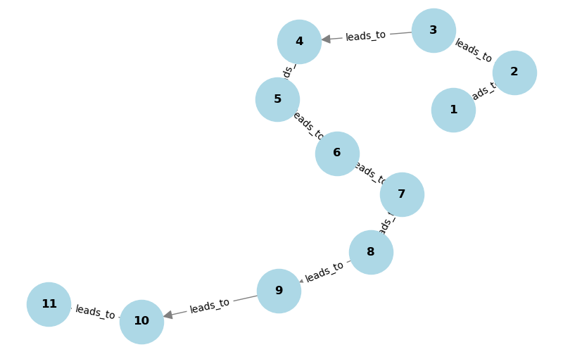
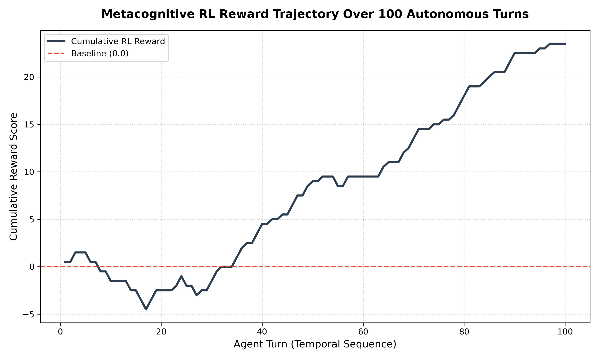

# RAMR: Metacognitive Drift Tracking in Autonomous LLM Orchestrators

[](https://www.python.org/)
[](https://ollama.ai/)
[-orange.svg)]()

This repository contains the implementation of **Representation Aware Memory Routing (RAMR)**, a hybrid vector-graph architecture designed to track and mitigate behavioral drift in autonomous Large Language Model (LLM) orchestrators. 

By unifying high-dimensional semantic search with chronological graph traversal, this system enables an agent to evaluate its own historical reasoning trajectories and autonomously self-correct *before* committing to a harmful or degraded operational state.

## 🧠 System Architecture

Traditional RAG (Retrieval-Augmented Generation) frameworks rely on flat vector similarity, which captures semantic intent but destroys causal and temporal topology. RAMR solves this by bridging the two:
1. **Semantic Vector Nodes:** Live Llama 3 thoughts are embedded (768-dimensional `nomic-embed-text`) and stored as nodes.
2. **Temporal Graph Edges:** Every action is linked via directed, weighted causal edges (`leads_to`), unrolling the agent's chain of thought over time.

Before executing a new action, the **Metacognitive Reflection Loop**:
* Queries the database for semantically similar past states.
* Traverses the graph history from that matched state.
* Overrides the current execution if the historical trajectory led to a safety refusal or failure.

### Figure 1: Metacognitive Memory Graph
*(The temporal traversal of agent states, captured live via NetworkX during execution)*


## ⚡ Performance & Results

During a 100-turn autonomous swarm simulation featuring a randomized mix of safe intents and adversarial attacks, the RAMR framework demonstrated a clear ability to stabilize agent behavior:
* **Latency:** Averaged **~36 milliseconds** per turn (Live Embedding + Semantic Search + Multi-hop Traversal + RL Override + Database Commit).
* **Reinforcement Learning:** Achieved a cumulative RL reward score of **+25.0**, successfully mitigating repetitive drift into vulnerable states.

### Figure 2: RL Reward Trajectory
*(The cumulative reward curve demonstrating autonomous behavioral stabilization)*


## 📂 Project Structure

* `lattice_memory_client.py` - Core Python wrapper for the native LatticeDB vector-graph REST API.
* `metacognitive_loop.py` - The standalone reflection logic for evaluating semantic state transitions.
* `autonomous_rl_agent.py` - The primary Llama 3 orchestrator integrating live Ollama embeddings and RL tracking.
* `antigravity_swarm.py` - The automated testing script that runs the 100-turn adversarial simulation.
* `plot_memory.py` & `plot_rl_curve.py` - Matplotlib/NetworkX visualizers for empirical data extraction.

## 🚀 Quickstart

### Prerequisites
1. **LatticeDB:** Must be running locally on port `6334` with a 768-dimension collection named `agent_memory`.
2. **Ollama:** Must be running locally on port `11434` with the `nomic-embed-text` model pulled.

```bash
# Start Ollama in the background
ollama serve

# Pull the required embedding model
ollama pull nomic-embed-text